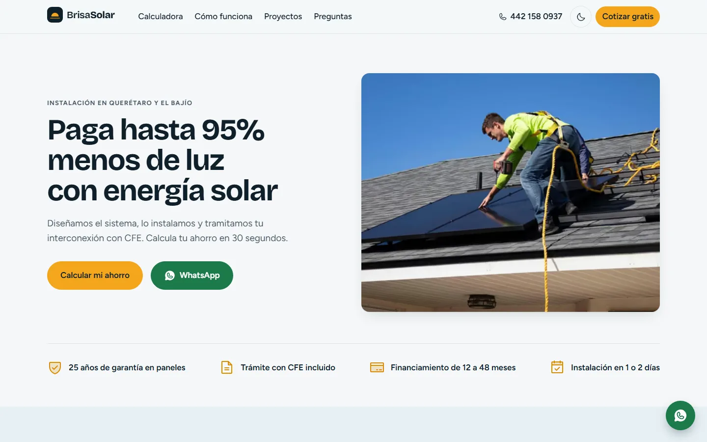
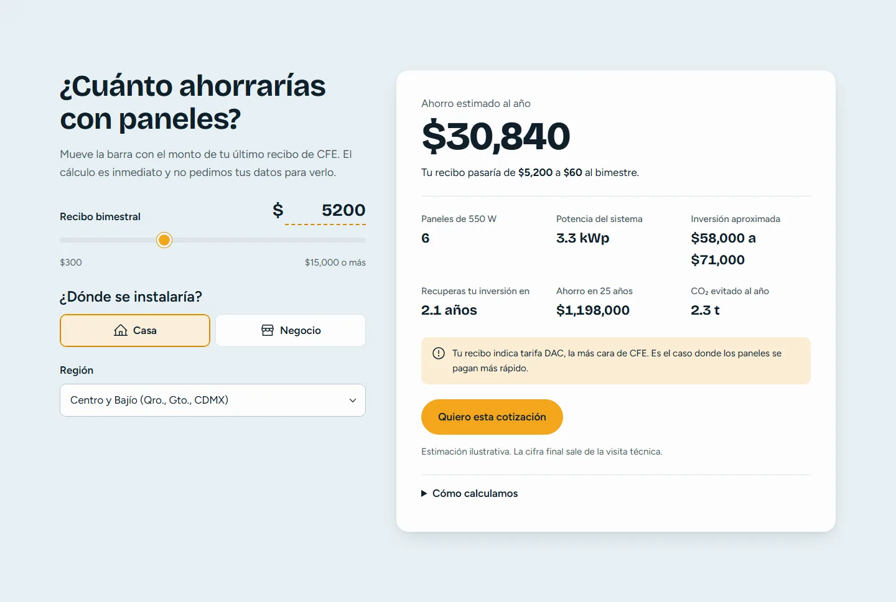
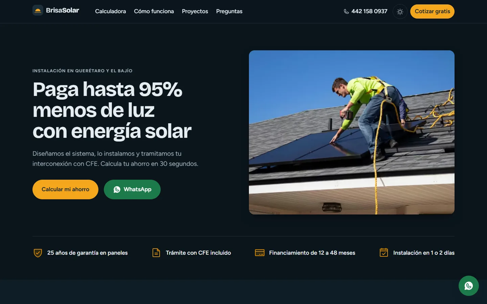
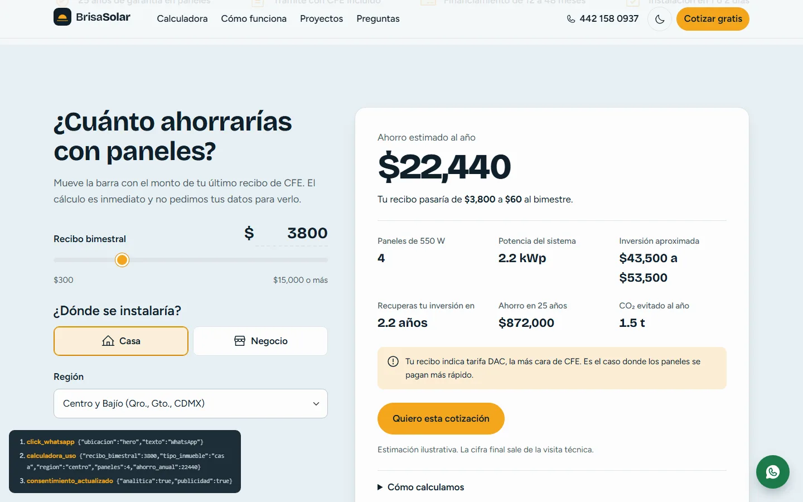
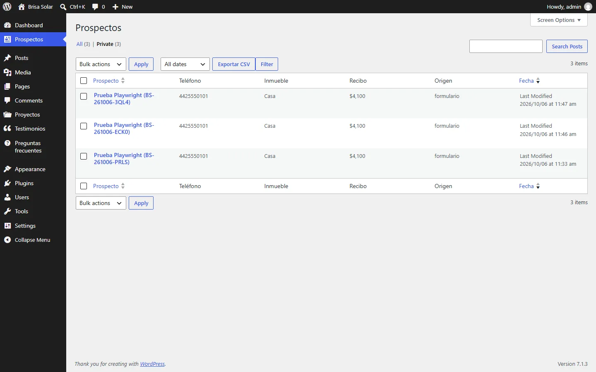
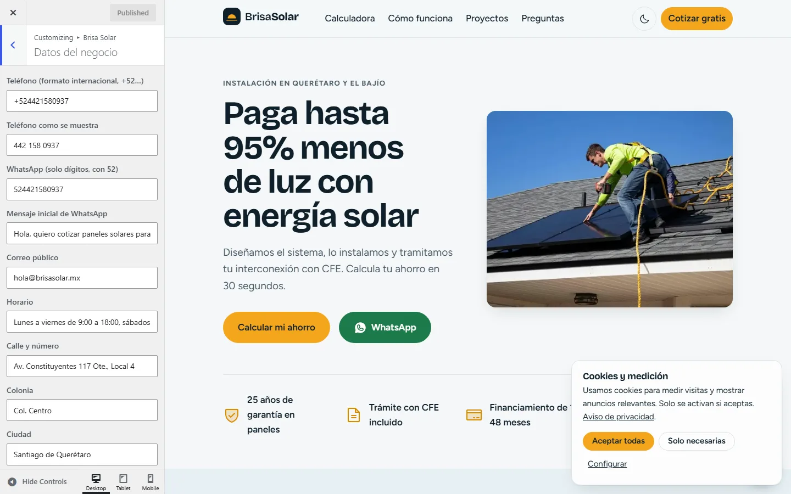
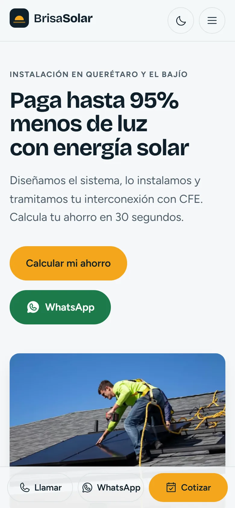

# Brisa Solar

Landing page de captación de prospectos para un instalador de paneles solares (empresa ficticia). Proyecto de portafolio con **HTML5, CSS3 (Bootstrap 5.3 + Sass), JavaScript/TypeScript, Astro, PHP y WordPress**, hecho a mano, sin constructores visuales.

**[Ver la demo en vivo](https://julianzamudio1.github.io/brisa-solar/)** · **[Abrir el tema en WordPress](https://playground.wordpress.net/?blueprint-url=https://raw.githubusercontent.com/julianZamudio1/brisa-solar/main/wordpress/blueprint.json)** (WordPress Playground: instala el tema con contenido de ejemplo en el navegador, sin cuenta)



## Qué incluye

1. **Landing orientada a conversión:** hero con CTA, calculadora de ahorro sobre el recibo de CFE, proceso, beneficios, carrusel de proyectos, testimonios, preguntas frecuentes, formulario, mapa y video bajo demanda.
2. **Contacto en cada punto:** WhatsApp con mensaje prellenado, botón flotante, barra fija en móvil, `tel:` y `mailto:`.
3. **Formulario completo:** validación accesible en el navegador y en el servidor (PHP 8 + SQLite), anti-bots, límite por IP, aviso por correo y página de gracias con folio.
4. **Medición para campañas:** `dataLayer` para Google Tag Manager, GA4, Pixel de Meta y Google Ads, Google Consent Mode v2, UTM adjuntos al prospecto y deduplicación con `event_id`. [Plan de medición](docs/medicion.md).
5. **Tema de WordPress** con el mismo CSS y JS, personalizador, tipos de contenido y prospectos en el administrador con exportación CSV. [Detalles](docs/wordpress.md).
6. **Rendimiento y SEO técnico:** Lighthouse **99/100/100/100 en móvil y 100 en todo en escritorio**, CLS 0, JSON-LD, sitemap. [Detalles](docs/rendimiento.md).

## Capturas

| Calculadora | Formulario con validación |
|---|---|
|  |  |

| Modo oscuro | Panel de depuración de la medición |
|---|---|
|  |  |

| Prospectos en WordPress | Personalizador del tema |
|---|---|
|  |  |

<p align="center"></p>

## Inicio rápido

```bash
cd site
npm install
npm run dev          # http://localhost:4321
```

| Comando (en `site/`) | Qué hace |
|---|---|
| `npm run build` | Sitio estático en `dist/` (incluye `api/` en PHP y `.htaccess`) |
| `npm test` | Pruebas unitarias de la calculadora (Vitest) |
| `npm run test:e2e` | Pruebas end-to-end en Chromium, Firefox, WebKit, Android e iPhone, con axe |
| `npm run validar:html` | Valida el HTML generado |
| `npm run tema` | Compila CSS, JS y datos hacia el tema de WordPress |

| Comando (en `herramientas/`) | Qué hace |
|---|---|
| `npm run test:php` | Pruebas del backend PHP con PHP 8.3 en WebAssembly |
| `npm run wordpress` | WordPress con el tema y contenido de demo en http://127.0.0.1:9400 |
| `node probar-wordpress.mjs` | Envía el formulario en WordPress y verifica el prospecto |

## Documentación

| Documento | Contenido |
|---|---|
| [Medición](docs/medicion.md) | Eventos, Consent Mode, configuración de GTM, GA4 y Meta |
| [Despliegue](docs/despliegue.md) | Hosting con cPanel, dominio y DNS, HTTPS, WordPress, GitHub Pages |
| [WordPress](docs/wordpress.md) | Estructura del tema, contenido editable, prospectos, seguridad |
| [Rendimiento y SEO](docs/rendimiento.md) | Lighthouse, Core Web Vitals, SEO técnico, accesibilidad |
| [Calculadora](docs/calculadora.md) | Supuestos y tarifas |
| [Diseño](docs/diseno.md) | Paleta, tipografía, componentes |
| [Créditos](docs/creditos.md) | Fotos y licencias |

## Estructura

```
brisa-solar/
├── site/            Landing en Astro + Bootstrap (y endpoint PHP en public/api)
├── wordpress/       Tema clásico de WordPress y blueprints de Playground
├── herramientas/    Pruebas de PHP y WordPress sin instalar PHP
├── pruebas/php/     Pruebas unitarias de las reglas del formulario
└── docs/            Documentación, capturas y reportes de Lighthouse
```

Brisa Solar es ficticia: nombres, teléfonos y testimonios son de demostración.
